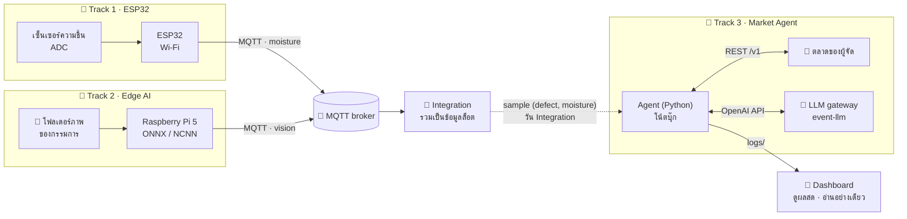

<div align="center">



# TESA Top Gun Rally #20 — ทีม Uten

🥇 **ผลรวม: 80.73 คะแนน · อันดับที่ 7 · เหรียญทอง**

**วัดความชื้นด้วย ESP32 → ตรวจคุณภาพเมล็ดด้วย AI บน Raspberry Pi 5 → ให้ agent ขายกาแฟในตลาดประมูลปิดซอง**

<sub>Chumphon Robusta AIoT Platform toward the Next-Gen Market · KMITL วิทยาเขตชุมพร 15–21 พ.ย. 2569 ·
คณะวิศวกรรมศาสตร์ ศรีราชา มหาวิทยาลัยเกษตรศาสตร์</sub>

[](track1-esp32/)
[](track2-edge-ai/)
[](track3-market-agent/)
[](track2-edge-ai/)
[](docs/agile.md)

</div>

---

## 📌 สารบัญ
- [ภาพรวม](#-ภาพรวม)
- [3 Track](#-3-track)
- [สัญญาข้อมูลระหว่าง Track](#-สัญญาข้อมูลระหว่าง-track)
- [ไทม์ไลน์](#-ไทม์ไลน์)
- [เริ่มใช้งาน](#-เริ่มใช้งาน)
- [โครงสร้าง repo](#-โครงสร้าง-repo)
- [กติกาของทีม](#-กติกาของทีม)
- [เอกสารเพิ่มเติม](#-เอกสารเพิ่มเติม)

## 🔍 ภาพรวม
แต่ละ Track แยกโฟลเดอร์และทำงานได้เอง คุยกันผ่าน **JSON ตามสัญญาข้อมูล** เท่านั้น จึงพัฒนาพร้อมกันได้โดยไม่ต้องรอกัน
และรวมเป็นระบบเดียวในวัน Integration (19 พ.ย.)



<sub>ช่วงขายแข่ง (17, 18, 20 พ.ย.) agent ใช้ค่า `sample` ที่ตลาดให้มาเอง เส้นประคือการเชื่อมเฉพาะโจทย์ Integration</sub>

## 🧩 3 Track

| | 🔌 Track 1 · ESP32 | 🍓 Track 2 · Edge AI | 🤖 Track 3 · Market Agent |
|:--|:--|:--|:--|
| **ผู้ดูแล** | June, Jeff | Boss, Peach | Phu |
| **รับเข้า** | ค่า ADC จากเซ็นเซอร์ที่ประกอบเอง | โฟลเดอร์ภาพเมล็ดที่กรรมการให้ (มี label) | `GET /v1/state`, `/v1/calendar` ของตลาด |
| **ส่งออก** | `moisture_pct` ผ่าน MQTT | จำนวนเม็ดต่อคลาส + `defect_pct` | ผลประเมินมูลค่า + ข้อเสนอขายทุกรอบ |
| **รันที่** | ESP32 | Raspberry Pi 5 (8 GB, ห้าม AI HAT) · เทรนบน HPC | โน้ตบุ๊กในห้องแข่ง |
| **ภาษา / เครื่องมือ** | C/C++ · Arduino IDE | Python · ONNX Runtime / NCNN | Python · httpx · openai |
| **โฟลเดอร์** | [`track1-esp32/`](track1-esp32/) | [`track2-edge-ai/`](track2-edge-ai/) | [`track3-market-agent/`](track3-market-agent/) |

<details>
<summary>คะแนนของแต่ละส่วน (จากเอกสารผู้จัด)</summary>

- **ทุกวัน:** ส่งซอร์สโค้ดก่อน 18:00 และสาธิตให้กรรมการ (กรรมการอย่างน้อย 3 คน)
- **Track 3:** ประเมินมูลค่า 20 คะแนน + ขาย 80 คะแนนจาก PR = (รายได้ + 0.80 × TV ที่เหลือ) ÷ TV ทั้งหมด · น้ำหนักวัน 17 / 18 / 20 = 15% / 35% / 50% (ตามสไลด์วันที่ 20)
- **ผล Track 3 ของทีม:** ด่าน 1 ขายมือ อันดับ 16 · ด่าน 2 agent อันดับ 12/56 (PR 0.955)
- **แนวคิดหลักที่ได้จากตลาดจริง:** นี่คือการแข่งขัน ไม่ใช่การขายให้ได้ราคาตรง TV · ทุกทีมได้ล็อตชุดเดียวกันและแย่ง RFQ ชุดเดียวกัน ราคาจึงลดลงทุกรอบ รอบแรก ๆ คือรอบที่ขาดทุนน้อยที่สุด · agent จึงต้องตั้งราคาให้ **ชนะและขายได้ตั้งแต่รอบแรก** แทนการถือของไว้รอราคาใกล้ TV แล้วไปขายถูกกว่าในรอบท้าย
- **รางวัล:** ชนะเลิศ 50,000 · รองอันดับ 1 30,000 · รองอันดับ 2 20,000 · ชมเชย 10,000 · Daily Top Score · Popular Vote
</details>

## 🔌 สัญญาข้อมูลระหว่าง Track
รูปแบบเต็มอยู่ใน [docs/data-contract.md](docs/data-contract.md) ตัวอย่างไฟล์อยู่ใน [`contracts/`](contracts/)

| จาก → ถึง | Topic MQTT | ช่องหลัก |
|:--|:--|:--|
| Track 1 → Integration | `tgr/lot/{lot_id}/moisture` | `lot_id`, `ts`, `moisture_pct`, `raw_adc` |
| Track 2 → Integration | `tgr/lot/{lot_id}/vision` | `lot_id`, `ts`, `counts`, `total`, `defect_pct` |
| Integration → Track 3 | `tgr/lot/{lot_id}/sample` | `sample.defect_pct`, `sample.moisture_pct`, `sample.screen` (ชื่อเดียวกับ API ตลาด) |

## 🗓 ไทม์ไลน์

| วันที่ | ช่วง | สิ่งที่เกิด |
|:--|:--|:--|
| 10–15 พ.ย. | เตรียมตัว | งานเตรียมรายคนตาม [บอร์ด](docs/sprint-board.csv) (`PREP`) |
| 16 พ.ย. | Sprint 0 | เปิดงาน บรรยายโจทย์ อบรม PM · Kickoff |
| 17 พ.ย. | Sprint Day 1 | อบรมแยกห้อง → ทำโจทย์ · Track 3 ขายด้วยมือ (15%) |
| 18 พ.ย. | Sprint Day 2 | อบรมแยกห้อง → ทำโจทย์ · Track 3 agent ขาย (35%) |
| 19 พ.ย. | Sprint Day 3 | โจทย์ Integration ทั้งวัน |
| 20 พ.ย. | Sprint Day 4 | พัฒนาต่อ → Presentation · Track 3 แข่งจริง (50%) |
| 21 พ.ย. | Demo | Live Demonstration · ประกาศรางวัล |

## 🚀 เริ่มใช้งาน
```bash
git clone https://github.com/thanapond-vi/topgun2026.git && cd topgun2026
```

**Track 3 · ทดสอบ agent กับตลาดจำลอง (ไม่ต้องใช้ key)**
```bash
cd track3-market-agent
pip install -r requirements.txt
python3 mock/run_games.py --games 200 --teams 56           # PR และอันดับเฉลี่ยในตลาดจำลอง
```
วันแข่ง: `cp .env.example .env` แล้วใส่ `MARKET_URL`, `TEAM_KEY`, `LLM_*` ที่ทีมงานแจก (ไฟล์ `.env` ไม่อยู่ใน Git) จากนั้น `python3 main.py`
ค่ากลยุทธ์ที่ปรับระหว่างแข่งอยู่ใน `strategy.env` (ไม่มี key)

**Track 2 · เทรนโมเดล** เทรนบน HPC ของมหาวิทยาลัย แล้วนำไฟล์ `.onnx` มารันบน Pi ดู [track2-edge-ai/](track2-edge-ai/)

**Track 1 · ESP32** เปิด Arduino IDE ติดตั้ง board `esp32` (Espressif) แล้วเปิดโค้ดใน `track1-esp32/firmware/`

## 🧭 โครงสร้าง repo
```text
topgun2026/
├── README.md                 หน้านี้
├── assets/header.svg         ภาพหัว
├── contracts/                ตัวอย่าง JSON ระหว่าง Track (moisture · vision · lot)
├── docs/
│   ├── architecture.md       สถาปัตยกรรม การไหลของข้อมูล และหน้าที่ของแต่ละส่วน
│   ├── data-contract.md      สัญญาข้อมูล (ชื่อช่อง หน่วย topic)
│   ├── agile.md              แผนทีมและปฏิทิน Agile 16–20 พ.ย.
│   ├── sprint-board.csv      บอร์ดงาน (เปิดด้วย Excel / Google Sheets)
│   └── track3-strategy.md    กลยุทธ์การประมูลของ Track 3
├── track1-esp32/             firmware/ · calibration/
├── track2-edge-ai/           configs/classes.yaml · train/ (HPC) · infer/ (Pi) · models/
├── track3-market-agent/      agent (main · strategy · appraisal · memory · llm) + mock/ ตลาดจำลอง
└── integration/              MQTT broker (mosquitto.conf) และตัวรวมข้อมูลล็อต
```

## 🤝 กติกาของทีม
- **1 Track = 1 โฟลเดอร์** แก้เฉพาะโฟลเดอร์ของตัวเอง ถ้าต้องเปลี่ยนสัญญาข้อมูล คุยในทีมก่อนแล้วแก้ `docs/data-contract.md`
- **ห้าม commit ความลับ:** `.env`, key ของตลาด, passphrase, private key ทุกชนิด
- **ห้ามเก็บไฟล์ใหญ่:** weight โมเดลและ dataset ไว้นอก Git (ใส่ path ไว้ใน README ของ Track)
- **ส่งงานทุกวันก่อน 18:00** แล้ว tag: `git tag day17-submit` (ตามวันที่)
- **ช่วง 2–3 ของ Track 3** ห้ามส่งคำสั่งขายด้วยมือ และใช้ LLM ได้เฉพาะ gateway ของผู้จัด

## 📚 เอกสารเพิ่มเติม
- [docs/architecture.md](docs/architecture.md) — อธิบายระบบทั้งหมดแบบละเอียด
- [docs/track3-strategy.md](docs/track3-strategy.md) — เหตุผลและกลยุทธ์การประมูล
- คู่มือ API ตลาด อยู่ใน [starter ของผู้จัด](https://github.com/khthana/Coffee-TESA-starter)

## 🙏 ขอบคุณ
สมาคมสมองกลฝังตัวไทย (TESA) · KMITL วิทยาเขตชุมพร · ผู้จัด Track 3 สำหรับ [starter agent](https://github.com/khthana/Coffee-TESA-starter)
