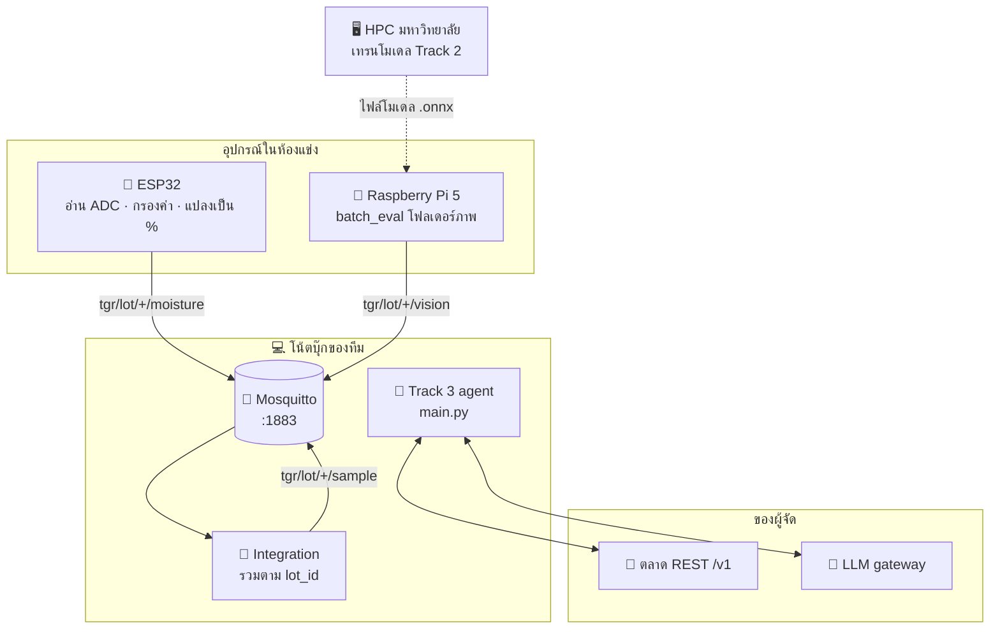

# 🏗 สถาปัตยกรรมระบบ

เอกสารนี้อธิบายว่าแต่ละส่วนทำอะไร อยู่ที่ไหน รับอะไรเข้า ส่งอะไรออก และเชื่อมกันอย่างไร
ภาพรวมแบบสั้นอยู่ใน [README](../README.md)

## หลักการออกแบบ
1. **แยกตาม Track:** แต่ละ Track เป็นโฟลเดอร์ของตัวเอง รันและทดสอบได้เองโดยไม่ต้องรอ Track อื่น
2. **คุยกันผ่านสัญญาข้อมูลเท่านั้น:** ส่ง JSON ตาม [data-contract.md](data-contract.md) ผ่าน MQTT ถ้า Track ไหนยังไม่เสร็จ ใช้ไฟล์ใน `contracts/` แทนข้อมูลจริงได้
3. **ใช้ชื่อช่องเดียวกับตลาดของผู้จัด:** ข้อมูลล็อตที่รวมแล้วใช้ `defect_pct`, `moisture_pct`, `screen` เหมือน API ตลาด จึงส่งเข้าสูตร TV ของ Track 3 ได้ทันที
4. **อ่านกติกาจากผู้จัด ไม่ฝังตัวเลขในโค้ด:** สูตร TV, จำนวนรอบ และชื่อคลาส อ่านจาก API หรือไฟล์ config
5. **ทำงานได้แม้ไม่มีอินเทอร์เน็ต:** ไลบรารีและโมเดลเตรียมไว้ในเครื่องก่อนไปชุมพร

## ภาพรวมการไหลของข้อมูล

## แต่ละส่วนทำอะไร

### 🔌 Track 1 · ESP32 (`track1-esp32/`)
| | |
|:--|:--|
| หน้าที่ | อ่านค่าความชื้นจากเซ็นเซอร์ที่ประกอบเอง แปลงเป็น % ด้วยสมการ calibration แล้วส่งผ่าน Wi-Fi |
| รับเข้า | แรงดันจาก ADC (เลี่ยงพิน ADC2 เพราะใช้ร่วมกับ Wi-Fi ไม่ได้) |
| ส่งออก | JSON `moisture` ทุกประมาณ 3 วินาที |
| ทักษะที่ใช้ | Digital/Analog I/O, PWM, I2C, SPI, UART |
| ข้อควรระวัง | ไฟเลี้ยงไม่พอทำให้ Wi-Fi ผิดปกติ · ต่อ GND ร่วมกันทุกจุดเมื่อใช้บอร์ดจ่ายไฟแยก |

### 🍓 Track 2 · Edge AI (`track2-edge-ai/`)
| | |
|:--|:--|
| หน้าที่ | ตรวจเมล็ดในโฟลเดอร์ภาพของกรรมการ นับจำนวนเม็ดต่อคลาส คำนวณสัดส่วนเมล็ดเสีย |
| รับเข้า | โฟลเดอร์ภาพ (ไม่ใช้กล้องสด) และ label 7 คลาสจากผู้จัด |
| ส่งออก | JSON `vision` ต่อภาพหรือต่อล็อต และไฟล์ผลรวมของทั้งโฟลเดอร์ |
| เทรนที่ | HPC ของมหาวิทยาลัย |
| รันที่ | Raspberry Pi 5 RAM 8 GB บน CPU (ห้ามใช้ AI HAT) |
| แนวทางโมเดล | หาเม็ด (YOLO-seg / detection) + จำแนกทีละเม็ด (classifier เล็ก) · ชื่อคลาสอ่านจาก `configs/classes.yaml` |

### 🤖 Track 3 · Market Agent (`track3-market-agent/`)
| | |
|:--|:--|
| หน้าที่ | ประเมินมูลค่าล็อต (TV) ครั้งเดียว แล้วยื่นข้อเสนอขายทุกรอบให้ได้ PR สูงสุด |
| รับเข้า | `GET /v1/calendar` (สูตร TV, ปฏิทิน), `GET /v1/state` (ล็อต, RFQ, ผลรอบก่อน) |
| ส่งออก | `POST /v1/appraisals` (ครั้งเดียว), `POST /v1/offers:batch` (ทุกรอบ), `logs/decisions.jsonl` |
| รันที่ | โน้ตบุ๊กในห้องแข่ง ต่อเครือข่ายของงาน |
| สมอง | กฎใน Python (markup ต่อผู้ซื้อ, ปฏิทิน, การกระจายขาย) + LLM ของผู้จัดเป็นที่ปรึกษา |
| ทดสอบ | `mock/` ตลาดจำลองตามคู่มือ API · ปรับค่าจริงกับตลาดฝึกวันที่ 17–18 |
| ปรับระหว่างแข่ง | `strategy.env` อ่านใหม่ทุกรอบ (เพดาน markup ต่อประเภทผู้ซื้อ ฯลฯ) ไม่ต้องแก้โค้ด |

### 🧩 Integration (`integration/`)
| | |
|:--|:--|
| หน้าที่ | รับ `moisture` และ `vision` ของล็อตเดียวกัน (จับคู่ด้วย `lot_id`) แล้วรวมเป็น `sample` |
| broker | Mosquitto บนโน้ตบุ๊ก พอร์ต 1883 (ทีมต้องตั้งเอง ผู้จัดไม่มีให้) |
| ใช้เมื่อ | โจทย์ Integration วันที่ 19 พ.ย. และการสาธิตวันที่ 21 |

## วันไหนใช้อะไร
| วัน | Track 1 | Track 2 | Track 3 | Integration |
|:--|:--|:--|:--|:--|
| 17 พ.ย. | อบรม + โจทย์ | อบรม + Classification | ขายด้วยมือ (ใบประเมิน Excel) | — |
| 18 พ.ย. | อบรม + โจทย์ | อบรม + Detection/Segmentation | agent ขายแทน | — |
| 19 พ.ย. | ส่งค่าเข้า broker | ส่งผลเข้า broker | รับ `sample` ถ้าโจทย์ต้องการ | **ใช้เต็มที่** |
| 20 พ.ย. | ปรับแต่ง | ปรับแต่ง | แข่งจริง | สาธิต |

## สิ่งที่ยังไม่รู้ (อัปเดตเมื่อได้โจทย์จริง)
- รูปแบบโจทย์ Integration วันที่ 19
- ชื่อคลาสสุดท้ายของ Track 2 (สไลด์กับแหล่งอื่นไม่ตรงกัน)
- เครือข่ายในห้องแข่ง: ต่อ broker บนโน้ตบุ๊กจาก ESP32 และ Pi ได้หรือไม่
